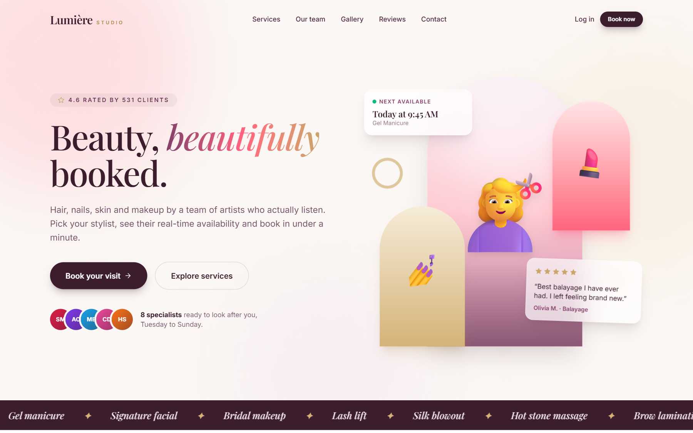
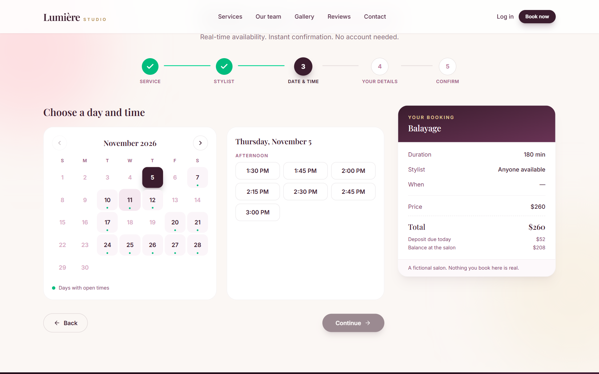
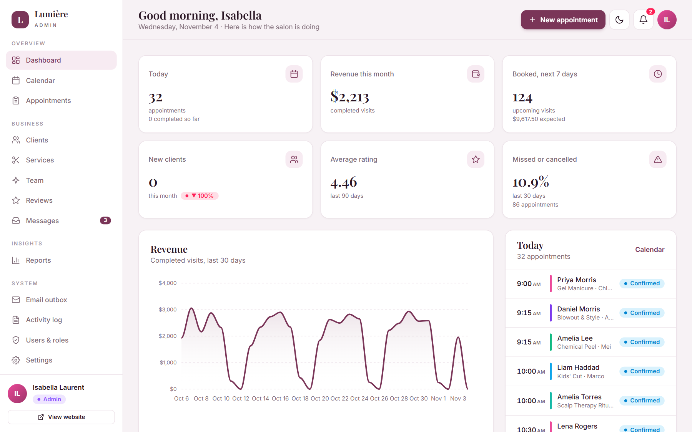
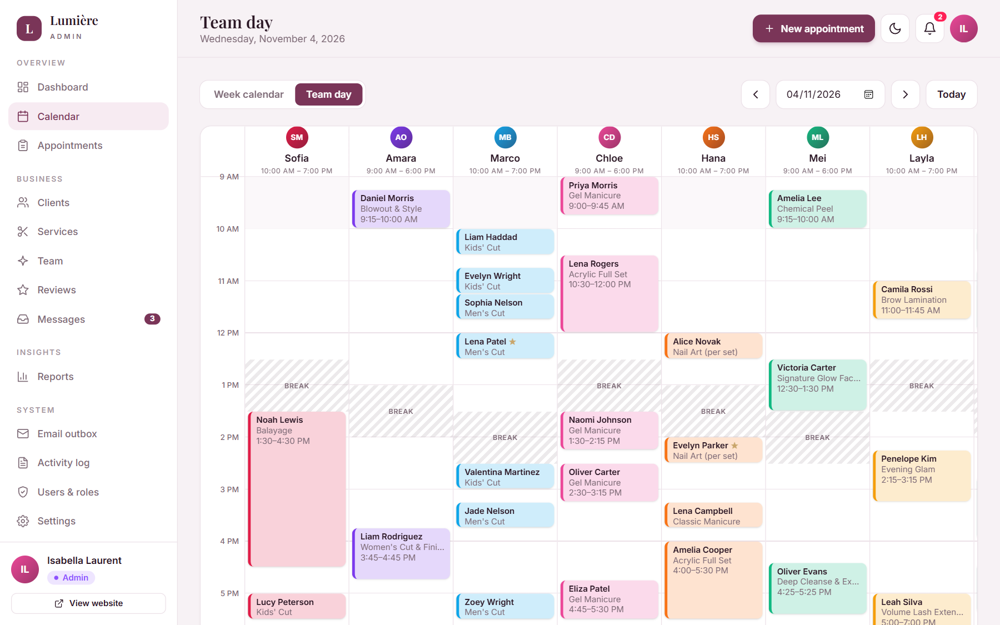
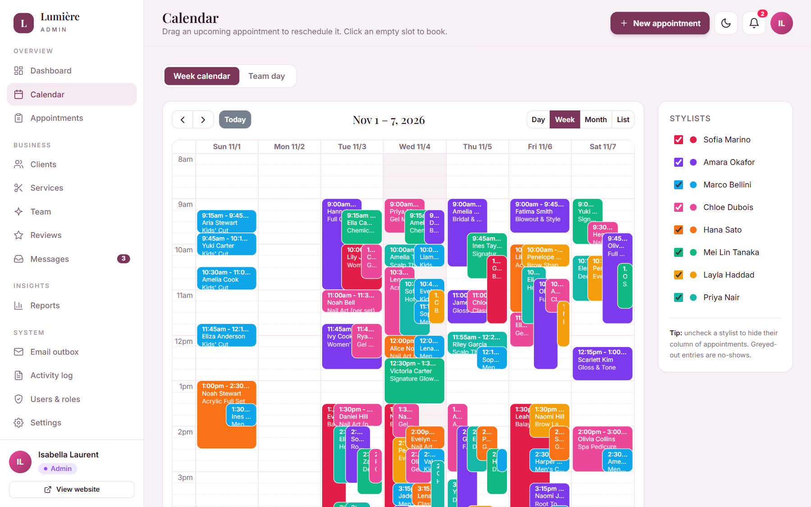
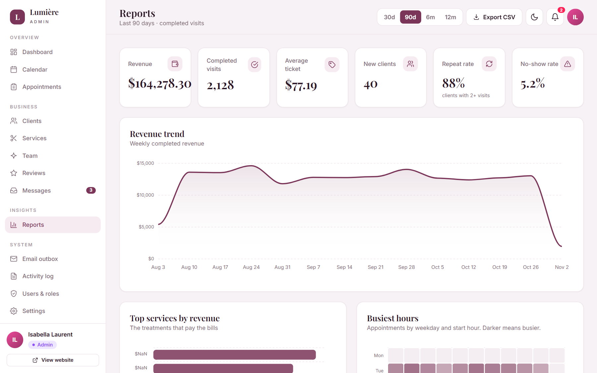
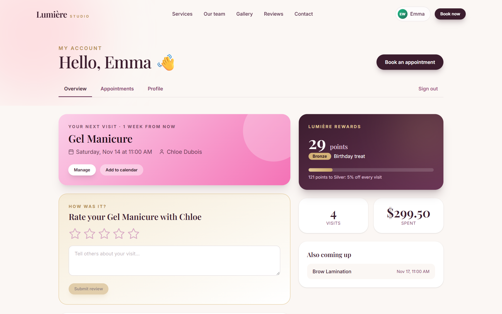
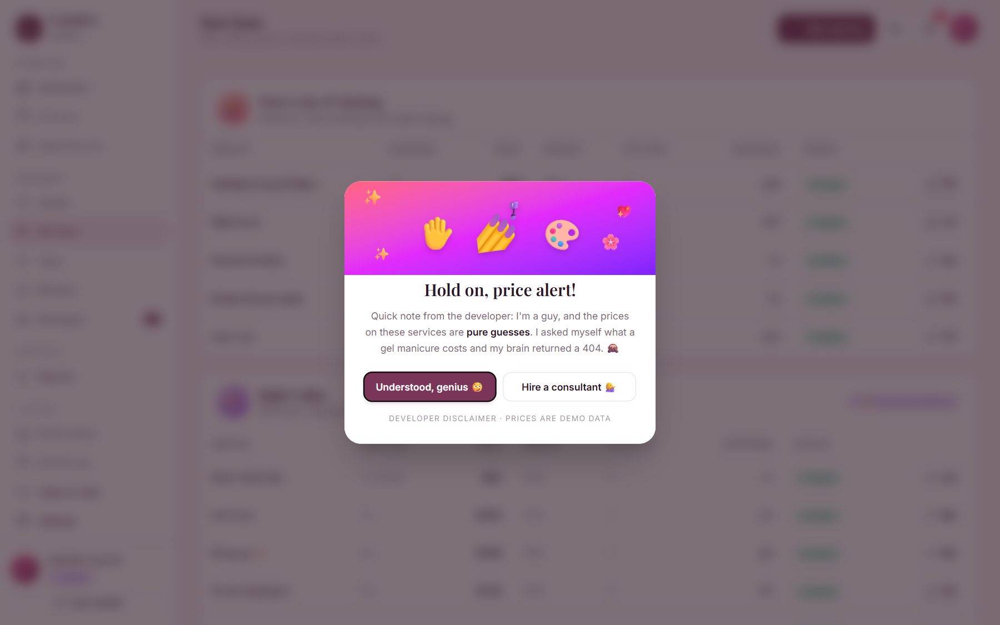
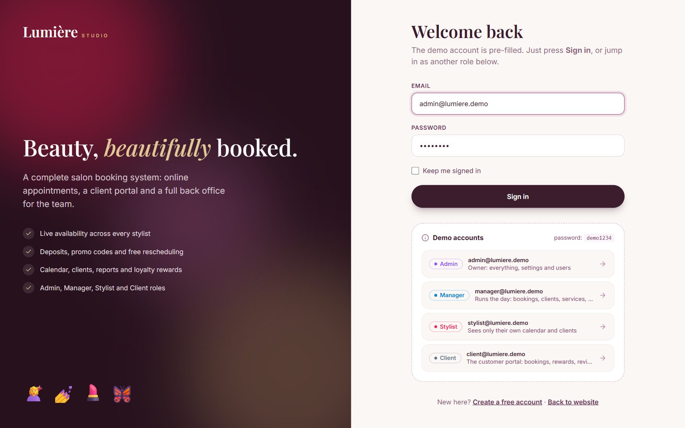

# Lumière Studio: Salon Booking System (Laravel)

A complete online booking system for a beauty salon, with a public website, a client portal and a full back office. Built with **Laravel 13**, **Tailwind CSS 4**, **Alpine.js** and **SQLite**. The salon, its clients and all prices are fictional demo data.

**Live demo: https://lumiere.150-230-43-127.sslip.io** (sign in with the pre-filled demo account)



| | |
|---|---|
|  |  |
|  |  |
|  |  |
|  |  |

## Demo login

The login form is pre-filled with the Admin account, and the other roles are one click away. The password for every demo account is `demo1234`.

| Email | Role | Can do |
|-------|------|--------|
| `admin@lumiere.demo` | Admin | Everything: settings, users & roles, activity log |
| `manager@lumiere.demo` | Manager | Bookings, clients, services, team, reviews, reports |
| `stylist@lumiere.demo` | Stylist | Only their own calendar, appointments and clients |
| `client@lumiere.demo` | Client | Customer portal: bookings, rewards, reviews |

The data is regenerated on the first request of every day, so anything changed during a demo is reset overnight. Demo accounts are reset in place, so signed-in visitors stay signed in.

## Features

**Public website**
- Responsive, animated landing page, service menu with search, team profiles, contact form
- 5-step booking wizard: service, stylist (or "anyone available"), live calendar with open days, details, deposit
- Real-time availability that respects opening hours, each stylist's shift, breaks, time off, closures, minimum notice and existing bookings, including cleanup buffers
- Deposits through a payment gateway interface (a test gateway is included, with decline test cards), promo codes, confirmation page, `.ics` calendar download, free cancellation window
- Double booking is prevented by re-checking the slot inside a database transaction

**Client portal**
- Upcoming and past appointments, cancel or reschedule, rebook in one click
- Loyalty points and tiers (Bronze, Silver, Gold), leave reviews

**Back office**
- Dashboard with KPIs, revenue trends, category and stylist charts, today's schedule, pending confirmations
- Week calendar with drag-and-drop rescheduling, and a "Team day" board with one column per stylist
- Appointments with filters, status changes, reminder emails and CSV export
- Clients (CRM) with segments, history, notes and VIP flags; services; team with weekly schedules and time off
- Reviews moderation and replies, contact inbox, email outbox (every email the system sends)
- Reports: revenue trend, top services, busiest hours heatmap, stylist utilization, no-show rate, top clients
- Settings for booking rules, opening hours, closures and promo codes
- Role-based access (Admin, Manager, Stylist, Client) enforced on the server, users management and an activity log
- Dark mode

## Tech stack

PHP 8.4 · Laravel 13 · SQLite (any Laravel database works) · Tailwind CSS 4 · Alpine.js · FullCalendar · ApexCharts · Vite · Docker (FrankenPHP)

## Run locally

Requires PHP 8.3+, Composer and Node 20+.

```bash
composer install
cp .env.example .env
php artisan key:generate
touch database/database.sqlite
php artisan migrate --seed
npm install && npm run build
php artisan serve
```

Open http://localhost:8000 and sign in with the pre-filled demo account. Run the tests with `php artisan test`.

## Run with Docker

```bash
docker build -t salon-booking .
docker run -p 8080:8080 -e APP_URL=http://localhost:8080 salon-booking
```

On start, the container creates the database, seeds the demo data and serves the app on port 8080. Set `APP_URL` to the public address when deploying behind a domain.

## How it is organized

```
app/Services/Availability.php      works out bookable times
app/Services/BookingService.php    booking, cancelling and rescheduling in one transaction
app/Services/Payments/             payment gateway interface and the test gateway
app/Http/Controllers/Admin/        back office
database/seeders/DemoSeeder.php    fictional salon, team, clients, appointments and reviews
app/Http/Middleware/DemoRefresh.php  daily demo reset
resources/views/                   Blade templates (site, account, admin)
tests/Feature/SalonTest.php        booking rules, roles and the daily reset
```

## Notes

- Emails are stored in the outbox page instead of being sent. Set `MAIL_MAILER` and the usual SMTP settings to deliver them.
- To take real payments, implement `PaymentGateway` for a provider such as Stripe and bind it in `AppServiceProvider`.
- The "developer disclaimer" pop-ups in the back office are a joke about the demo's made-up prices.
